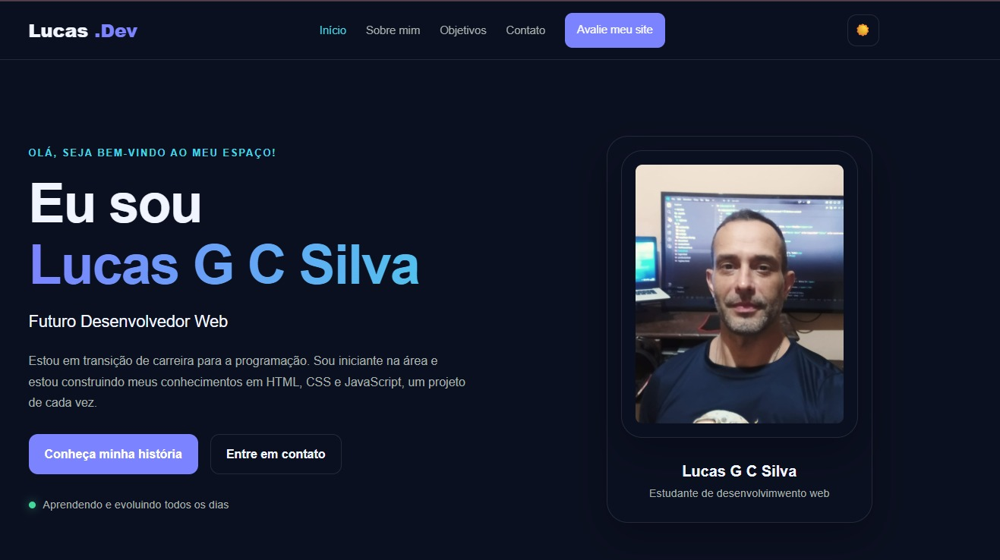

<h1>💻 Projeto pessoal | HTML5, CSS3 e JavaScript<h1</>
 
<h2>Bem-vindo ao meu projeto de portifólio Pessoal!</h2>
 

Este projeto foi desenvolvido como parte da minha jornada de aprendizado em Desenvolvimento Web, com o objetivo de colocar 
 em prática os conhecimentos adquiridos em HTML5, CSS3 e Javascript.

 

Atualmente estou em transição de carreira para a áre de tecnologia e desenvolvendo projetos práticos para aprimorar minhas
 habilidades em programção e desenvolvimento Front-end.

<b>
<h2>🌎 Sobre o projeto</h2>
 

O projeto consiste em um portifólio pessoal com uma interface moderna, responsiva e interativa, criado para apresentar um 
 pouco sobre mim, minha trajetória, meus objetivos profissionais e minha evolução na programação.

 

Além da página principal, o projeto conta com uma página de avaliação, permitindo que os visitantes interajam com o formulário e deixem 
suas opniões sobre o portifólio.
  
 
<h2>🔩🔨🔧 Tecnologias usadas</h2>
 
- 💀HTML5: etruturação semântica e organização do conteúdo das páginas.
   
- 👨CSS3: estilização, layouts, responsividade, efeitos visuais e animações.
   
- 💪JavaScript: interatividade, manipulação do DOM, menu responsivo, alternância entre temas e validação de fomrulários.
 
<h2>📱Responsividade</h2>
 

O projeto foi desenvolvido utilizando técnicas de CSS responsivo, buscando proporcionar uma boa experiência de navegação
em diferentes tamanhos de tela, como computadores, tablets e smartphones.

 
<h2>🌐 Acesse o projeto</h2>
<a href="https://lucasgcsilva81.github.io/meu-portifolio/" target="_blank">Clique para visitar meu portifólio</a>
 
<h2>👨‍💻 Sobre mim</h2>
 

Sou um profissional com mais de 10 anos de experiência na área de logística e atualmente estou em transição de carreira
para a área de Tecnologia.

 

Estou estudando HTML5, CSS3 e JavaScript, desenvolvendo projetos práticos e buscando minha primeira oportunidade profissional
 como Desenvolvedor Web.

  
 
Acredito no aprendizado contínuo, na dedicação e na prática como ferramentas fundamentais para o crescimento profissional.
 

  
 
Obrigado por visitar meu projeto! 🤟🏻😎

  
  
  
 
  
 
  
 

  
